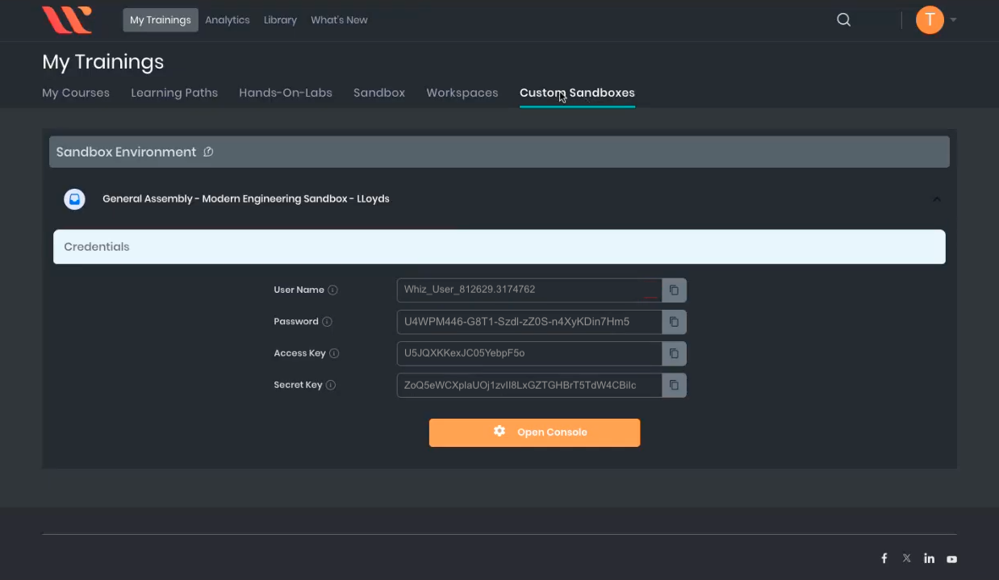

<h1>
  <span class="headline">Building a RESTful Microservice with Express</span>
  <span class="subhead">Provisioning DynamoDB with Terraform</span>
</h1>

**Learning objective:** By the end of this lesson, students will be able to provision and deploy a DynamoDB table on AWS using Terraform.

## Introducing Terraform

We have a working API running in a container, but the database we're using is currently only available locally. To make this more production ready, we need to deploy our database to the cloud. In this section, we'll use Terraform to provision a DynamoDB instance on AWS.

As a prerequisite to this section you'll need to have the following:

- AWS account credentials (Access Key and Secret Key)
- AWS Command Line Interface (CLI) installed

### Configuring AWS credentials

Before Terraform can interact with AWS services, you need to configure your AWS credentials.

<blockquote class="attention">
💡  If you have already done this step in a previous lesson, you can skip this section.
</blockquote>

### Get AWS access keys from Whizlabs

> **_Pro tip: Log in to Whizlabs from your Amazon Workspace VM. The AWS Access Keys are very long and complex. You should copy and paste them directly from the browser into your terminal. Do not attempt to type them manually—typos are almost guaranteed and will cause authentication failures, requiring you to repeat this step._**

#### 1. On your Amazon Workspace virtual machine, open a web browser.

#### 2. Navigate to the Whizlabs training dashboard: [https://business.whizlabs.com/learn/my-training/](https://business.whizlabs.com/learn/my-training/)

- You'll find the access keys you need in your **Whizlabs Custom Sandbox**.

- Once the sandbox environment loads, you should see your `AWS Access Key ID` and `AWS Secret Access Key` displayed on the screen.
- These credentials are required for configuring your AWS CLI.

<br>



<br>

#### 3. Back in your terminal window type:

```bash
aws configure
```

#### 4. You will be prompted to enter your AWS credentials and default region settings...

```plaintext
*** Example Only ***

[your-workstation-987541-1235qa-c80z56]$  aws configure
AWS Access Key ID [None]:  AKIAJWTHXU9P44LFQMLK
AWS Secret Access Key [None]:  bXrTqVyW9nJ784Tp5PLMSxwruNYdCR3kOzFpAZEm
Default region name [None]:  us-east-1
Default output format [None]:
[your-workstation-987541-1235qa-c80z56]$
```

> **_Copy and Paste: The access keys are long and complex. Avoid typing them manually to prevent errors._**

#### 5. Verify Your Configuration

If you think you entered an incorrect value you can check your AWS config file by typing the command:

```bash
cat ~/.aws/credentials
```

This will print the contents of your `.aws` config file to your terminal so that you can verify the correct values were entered:

```bash
aws_access_key_id = YOUR_ACCESS_KEY_ID
aws_secret_access_key = YOUR_SECRET_ACCESS_KEY
...
```

Ensure that both the `Access Key ID` and `Secret Access Key` match the ones provided by Whizlabs.

If there is an error you can reenter the credentials by typing:

```bash
aws configure
```

and completing the process again.

## Using Terraform

Now we can generate new infrastructure with code using terraform.

### 1. Create the Terraform configuration file

In the root of your project, create a new file called `accounts_database.tf`:

```sh
touch accounts_database.tf
```

Copy the following code into `accounts_database.tf` to set up the DynamoDB table:

```hcl
provider "aws" {
  region = "us-east-1"
}

resource "aws_dynamodb_table" "accounts" {
  name         = "Accounts"
  billing_mode = "PAY_PER_REQUEST"
  hash_key     = "id"

  attribute {
    name = "id"
    type = "S"
  }

  tags = {
    Name = "AccountsTable"
  }
}
```

This code configures the AWS provider, defines the DynamoDB table with a primary key `id`, and tags the table for identification.

### 2. Initialize Terraform

Run the following command to initialize your Terraform environment and download the necessary providers:

```sh
terraform init
```

### 3. Preview the Changes

Before making changes, run this command to see what Terraform plans to do:

```sh
terraform plan
```

Review the output to confirm that Terraform will create the infrastructure we want.

### 4. Apply the changes

If the plan looks correct, apply the changes by running:

```sh
terraform apply
```

Type `yes` when prompted to confirm that you want Terraform to provision the resources in your AWS account.

<blockquote class="attention">
! Important Note: After Terraform completes, navigate to your AWS account's DynamoDB console to verify that the "Accounts" table has been created.
</blockquote>
